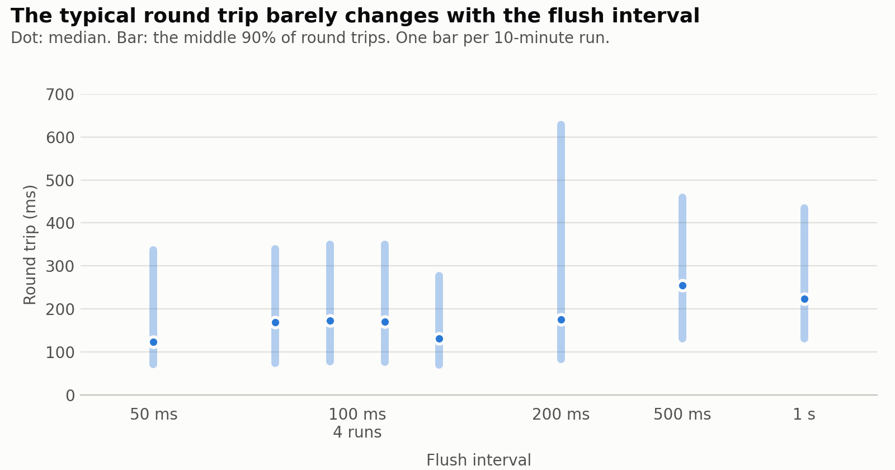
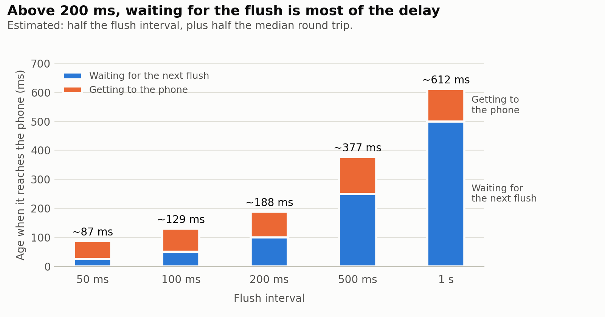
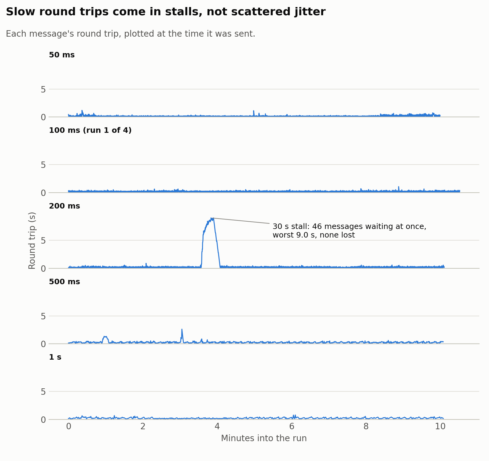

# How often should the watch send? A Wristscope connection benchmark

Wristscope streams Apple Watch motion data to an oscilloscope on a Mac. The watch reads its motion
sensors 100 times a second and sends the readings to the iPhone in batches. Each send is a *flush*, and the time
between them is the *flush interval*. A short interval gets readings to the screen sooner, but means
more messages. A long one sends fewer, bigger messages, and every reading waits longer before it
leaves the watch.

This benchmark measures what each choice costs on the watch-to-phone link, and how reliable that
link is.

> **TODO before publishing:** fill in the device details under Setup, the CPU and battery results
> under [What streaming costs the watch](#what-streaming-costs-the-watch), and the two notes marked
> TODO in the [table of runs](#every-run).

## Summary

- **No message was lost.** All 41,291 messages over 81 minutes and eight runs reached the phone.
- **The link stalls instead of dropping messages.** Seven times, round trips climbed past a second
  while messages queued up, and then everything arrived late. The longest stall lasted 30 seconds, with
  46 messages waiting at once and a worst round trip of 9.0 s.
- **The typical round trip barely depends on message size.** The median stayed between 124 and
  255 ms while messages grew 20 times larger, from 870 bytes to 17 KB. The cost of a message is
  mostly per message, not per byte.
- **Fresh data comes from flushing often.** At 50 ms, a reading is an estimated 87 ms old when it
  reaches the phone. At 1 s it is 612 ms old, and most of that is waiting for the next flush.
- **Recommendation: keep the 50 ms flush interval** the app now uses, unless its battery cost turns
  out much higher than at 1 s. *(TODO: confirm with the CPU and battery runs.)*

## Setup

```
Apple Watch ──WatchConnectivity──▶ iPhone ──USB──▶ Mac (wristscope)
              (measured here)              (not measured here)
```

- **Watch to phone:** `WCSession.sendMessageData` with a reply handler. The system decides whether
  a message goes over Bluetooth or Wi-Fi.
- **Phone to Mac:** TCP over USB through usbmuxd. Losses on this hop show in the oscilloscope's
  status bar but aren't part of this benchmark.
- **Data:** device motion (attitude, user acceleration, rotation rate, gravity) and the raw
  accelerometer at 100 Hz, about 173 bytes per reading on the wire.
- **Keeping the app running:** a HealthKit workout session, so the app keeps streaming with the
  screen off.
- **Devices:** *TODO: Apple Watch model and watchOS version, iPhone model and iOS version.*
- **Conditions:** *TODO: where you ran it, how far apart the watch and phone were, wrist up or down.*

## Method

A debug setting on the watch logs every live message:

- when it was handed to WatchConnectivity, and how many bytes it was
- when the phone's reply came back
- any error, and any flush the watch couldn't send because the phone was out of reach

Both timestamps for a round trip come from the watch's own clock (`systemUptime`), so the
measurement needs no clock sync between the watch and the phone. When a session ends, the log goes
to the phone as a file.

The runs:

- **Phase 0:** four 10-minute runs at 100 ms, to see how much the same setting varies from run to run.
- **Phase 1:** one 10-minute run each at 50 ms, 200 ms, 500 ms and 1 s.
- **Phase 2:** 30-minute runs at 50 ms and 1 s with CPU, battery and thermal readings every 5 seconds.

Definitions:

- **Percentiles** use nearest rank.
- **Estimated age** of a reading when it reaches the phone is half the flush interval (the average
  wait for the next flush) plus half the median round trip (assuming the trip there and the reply
  take about the same time).
- **A stall** is a stretch of round trips over 1 s, counting slow messages sent within 5 s of the
  last one as the same stall.

`tools/benchmark_report.py` prints the numbers and `tools/benchmark_plots.py` draws the figures, so
every number here can be rebuilt from the logs in `benchmarks/`.

## Results

### Every message arrived

All 41,291 messages in Phases 0 and 1 got a reply. WatchConnectivity reported no errors, and the
phone was never out of reach. The two runs left out of the figures (listed in the
[table of runs](#every-run)) lost nothing either.

### The typical round trip barely changes

<picture>
  <source media="(prefers-color-scheme: dark)" srcset="figures/round-trips-dark.png">
  
</picture>

Across a 20-times range in message size, the median round trip stayed between 124 and 255 ms. A
message costs about the same whether it carries 5 readings or 100.

The four Phase 0 runs show how much the same setting varies: medians of 131 to 173 ms, a spread of
about 40 ms. That spread is about as big as the differences between 50, 100 and 200 ms. With one run
per interval in Phase 1, those three can't be ranked by round trip alone.

### Fresher data comes from flushing more often

<picture>
  <source media="(prefers-color-scheme: dark)" srcset="figures/sample-age-dark.png">
  
</picture>

The time to reach the phone stays at about 60 to 130 ms. The wait for the next flush grows with the
interval: from 200 ms up, it is most of a reading's age. For a live oscilloscope, the shortest
interval gives the freshest picture.

### Slow round trips come in stalls

<picture>
  <source media="(prefers-color-scheme: dark)" srcset="figures/stalls-dark.png">
  
</picture>

Round trips over a second were rare and came in bursts. Over 81 minutes there were seven stalls:

- **One long stall:** 30 seconds in the 200 ms run. Round trips climbed steadily to 9.0 s as up to
  46 messages waited for replies, then drained. That one stall accounts for the 200 ms run's p99 of
  8.5 s.
- **Six short ones:** 1 to 7 seconds each, with round trips up to 2.6 s.
- **Early stalls:** two of the eight runs stalled 14 to 22 seconds after starting, and so did a
  short first test. The cause is still unknown.

No stalled message was lost. For a live view, a stall shows up as a delay, not as missing data.

### A bug the benchmark found

watchOS sometimes pauses the app briefly. When it resumes, every reading it missed arrives at once.
One 1.1-second pause overflowed the send buffer, which was sized for two 50 ms flushes. The buffer is
now sized for two seconds of readings. Messages bigger than usual are probably these pauses showing
up in the logs: the 50 ms run's largest message was 2.5 KB, against a typical 870 bytes.

*TODO: check this matches what you saw, and say what overflowing did (readings dropped, or an extra
message).*

### What streaming costs the watch

*TODO: after the Phase 2 runs, regenerate the figures (see [Reproducing](#reproducing)) and add the
watch-cost figure:*

```html
<picture>
  <source media="(prefers-color-scheme: dark)" srcset="figures/watch-cost-dark.png">
  
</picture>
```

*Then a sentence or two: CPU at 50 ms vs 1 s, battery per hour at each, and whether the difference
is big enough to matter. CPU covers this app only. The Bluetooth and WatchConnectivity work happens
in system processes, which only the battery level reflects.*

## Recommendation

Keep the 50 ms flush interval. It gives the freshest data, about 87 ms old on arrival, and its round
trips are no worse than longer intervals. Moving to 100 ms would add about 40 ms of age. Going above
200 ms would make waiting for the flush most of the delay.

*TODO: if the 50 ms run uses clearly more battery per hour than the 1 s run, say so here and whether
100 ms is the better trade.*

## Limitations

- One watch, one phone and one place, with 81 minutes of runs in Phases 0 and 1.
- One run per interval in Phase 1, so the small differences between 50, 100 and 200 ms are within
  run-to-run variation.
- Only the watch-to-phone hop is measured.
- A round trip includes the phone's handling and reply. The estimated age assumes the two legs take
  about the same time.
- At a fixed 100 Hz, message size and message rate change together, so their effects can't be
  separated here.
- The watch never left the phone's range, so recovery after a disconnection wasn't tested.
- Battery level moves in coarse steps, so the battery results need long runs and are approximate.

## Next steps

- **Repeat each interval three times** to rank 50, 100 and 200 ms with confidence.
- **Walk the watch out of range and back** to measure how long the stream takes to recover.
- **Separate message size from message rate** by changing the sample rate at a fixed interval.
- **Shrink the payload.** Of the 173 bytes per reading, 40 are timestamps: each measurement carries
  its own copy, though the four device-motion measurements share one. Values are 8-byte doubles,
  where 4-byte floats would do for sensor data. One timestamp per reading and floats would roughly
  halve message size. That matters more for battery than for latency, since size barely moved the
  round trip.
- **Share one schema** between the Swift and Python code, such as Protocol Buffers, instead of
  pinning the two together with fixture tests.
- **Log the phone-to-Mac hop** the same way, for an end-to-end picture.

## Every run

Times are round trips in milliseconds. Sizes are the median message size.

| Phase | Run | Flush | Minutes | Messages | Delivered | Median | p95 | p99 | Worst | Size | Stalls |
|---|---|---|---:|---:|---:|---:|---:|---:|---:|---:|---:|
| 0 | 1792610396 | 100 ms | 10.5 | 6,313 | 100% | 169 | 339 | 443 | 1,084 | 1,735 B | 1 |
| 0 | 1792611444 | 100 ms | 10.0 | 6,029 | 100% | 173 | 350 | 660 | 2,061 | 1,735 B | 1 |
| 0 | 1792612293 | 100 ms | 10.1 | 6,070 | 100% | 171 | 349 | 466 | 939 | 1,735 B | 0 |
| 0 | 1792614456 | 100 ms | 10.1 | 6,060 | 100% | 131 | 277 | 346 | 488 | 1,735 B | 0 |
| 1 | 1792621323 | 50 ms | 10.0 | 11,970 | 100% | 124 | 337 | 528 | 1,202 | 870 B | 2 |
| 1 | 1792622298 | 200 ms | 10.1 | 3,032 | 100% | 176 | 628 | 8,517 | 9,001 | 3,465 B | 1 |
| 1 | 1792623081 | 500 ms | 10.1 | 1,211 | 100% | 255 | 459 | 1,172 | 2,637 | 8,655 B | 2 |
| 1 | 1792623994 | 1 s | 10.1 | 606 | 100% | 223 | 434 | 554 | 812 | 17,305 B | 0 |
| – | 1792606878 | 100 ms | 1.3 | 770 | 100% | 257 | 2,132 | 2,515 | 2,881 | 1,735 B | 2 |
| – | 1792620243 | 100 ms | 9.6 | 5,767 | 5,766 + 1 waiting | 147 | 335 | 1,155 | 2,783 | 1,735 B | 2 |

The last two runs aren't in the figures. 1792606878 was a first test. 1792620243 ended with one
reply still on its way, which isn't a loss. *TODO: say what was different about 1792620243. If
nothing was, it can join Phase 0.*

## Reproducing

From the repository root, with the logs in `benchmarks/`:

```bash
python tools/benchmark_report.py --detail benchmarks/"Phase 0"/*.json benchmarks/"Phase 1"/*.json
pip install matplotlib
python tools/benchmark_plots.py --out docs/figures benchmarks/"Phase 0"/*.json benchmarks/"Phase 1"/*.json
```

Add `benchmarks/"Phase 2"/*.json` to both commands once those runs exist, for the CPU and battery
columns and the watch-cost figure.
